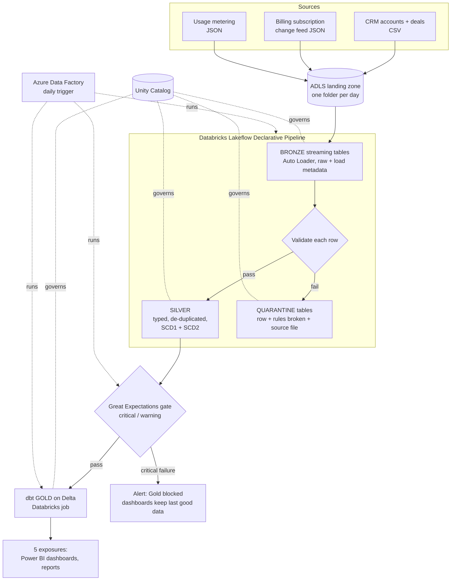
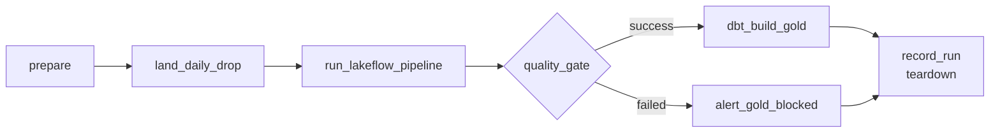

# System design: Databricks + dbt platform with data quality gates

This page explains how the system is put together, one step at a time. Follow it in order and you can redraw the design on a whiteboard.

## 1. Problem and requirements

A B2B SaaS company reports revenue from three feeds: CRM deals, a billing subscription change feed and product usage metering. Each feed had its own batch job and no shared checks. Negative MRR, duplicate usage events and unknown accounts went straight onto leadership dashboards, and nobody could say which dashboards a broken table affected.

| Type | Requirement | How the design meets it |
|---|---|---|
| Functional | Daily ARR, NRR, usage overage, customer health and pipeline reporting | dbt Gold models on Delta |
| Quality | Bad rows never reach Gold, and are not silently lost | Quarantine tables with the broken rules per row |
| Quality | If a problem cannot be fixed by removing rows, Gold must not refresh | Great Expectations gate with critical and warning checks |
| Availability | Dashboards always show the last correct numbers | Gate blocks the refresh instead of publishing bad data |
| History | Know what a subscription looked like on any date | SCD Type 2 history table |
| Lineage | Know which dashboards a table feeds | dbt exposures for 5 BI consumers |
| Measured | Data quality SLA | 50% of days clean without gates, 100% with them (10-day run) |

## 2. Architecture (production, Azure)



## 3. Local stand-ins

| Production | Local in this repo |
|---|---|
| Lakeflow Declarative Pipelines | Apache Spark 4 Declarative Pipelines (`spark-pipelines`), the open-source core of Lakeflow |
| Auto Loader | Streaming file source on the landing folder |
| `create_auto_cdc_flow` SCD2 | Window functions (`lead` over `updated_at`) in `02_silver.py` |
| Unity Catalog | Embedded Hive metastore shared by pipeline, gate and dbt |
| Delta on ADLS | Delta Lake on local disk |
| Databricks job (gate + dbt) | `quality/run_gate.py` and `dbt build` with `dbt-spark` |
| Azure Data Factory | Airflow 3.2 (`airflow/dags/`); the ADF JSON is in `adf/` |

The Databricks-native pipeline is `databricks/lakeflow_pipeline.py`, deployed by the bundle `databricks/databricks.yml`.

## 4. One business day, step by step

**Step 1. Land the day's files** (`generator/generate_daily_drops.py`). CRM accounts (full snapshot) and opportunities, billing subscription changes and usage events arrive in a dated folder. Some days include deliberate defects: negative MRR, an unsupported currency, usage for accounts that do not exist, future-dated usage, duplicate events.

**Step 2. Bronze** (`pipelines/transformations/01_bronze.py`). Streaming tables pick up only new files. Rows are kept exactly as they arrived, plus load metadata (source file, load time). Bronze is the replayable record of what the sources sent.

**Step 3. Validate and split** (`02_silver.py`). Each row is checked against rules (not null keys, known account, MRR not negative, currency in the allowed list, date not in the future). `failed_rules()` builds the list of rules a row breaks.
- No broken rules: the row goes to Silver.
- Any broken rule: the row goes to a `quarantine_*` table **with the rule names and the source file**, so it can be fixed and replayed. Nothing is silently dropped.

**Step 4. Silver shapes the data.**
- `silver_accounts`, `silver_opportunities`: latest version per key.
- `silver_usage`: one row per event; duplicates collapsed on `event_id`.
- `silver_subscriptions_history`: **SCD Type 2**. Every change is a row with `valid_from`, `valid_to`, `is_current`, so MRR on any past date can be rebuilt.
- `silver_subscriptions`: **SCD Type 1**, the current version only.

**Step 5. The quality gate** (`quality/run_gate.py`, `quality/expectations.py`). Great Expectations runs suites on the Silver tables. Each expectation is tagged:
- **critical**: unique and not-null keys, account exists, MRR not negative, currency and status in the allowed set, usage not in the future.
- **warning**: row volume in the expected range, seats in a normal range, valid segment.

Any critical failure stops the run here. Warnings are recorded but do not block.

**Step 6a. Gate passes: dbt builds Gold.**

| Gold model | Answers |
|---|---|
| `dim_customer` | One row per customer with segment |
| `fct_mrr_daily` | MRR per subscription per day (from the SCD2 history) |
| `fct_pipeline` | Open deals by stage |
| `rpt_arr_by_product` | ARR per product |
| `rpt_net_revenue_retention` | NRR and GRR |
| `rpt_usage_overage` | Customers using more than they pay for (upsell candidates) |
| `rpt_customer_health` | At-risk customers |
| `rpt_data_quality_daily` | Quarantine counts and gate results per day |

dbt tests run in the same build, including `assert_arr_matches_customer_mrr` and `assert_nrr_within_bounds`. `exposures.yml` links each dashboard to the models it reads.

**Step 6b. Gate fails: Gold is not refreshed.** `dbt_build_gold` is skipped and `alert_gold_blocked` runs. Dashboards keep showing the previous day's correct numbers, which is better than showing wrong ones on time.

**Step 7. Record the run** (`scripts/record_run.py`). Gate results, quarantine counts and the outcome are stored per day. This task is an Airflow **teardown**, so it runs even when an earlier task fails and the failure is still visible on the run.

**Step 8. Measure the SLA** (`revenue_quality_report`). The same days are re-checked as raw drops without quarantine or gate (the baseline), then compared with the gated runs. Result: 5 of 10 days would have shipped a critical defect without gates; with gates, 10 of 10 days published clean Gold.

## 5. Orchestration



- `revenue_quality_daily`: `@daily`, 1 to 10 June 2026 with catch-up, one simulated business day per run.
- `revenue_quality_report`: manual; baseline on raw drops, dbt scorecard, writes `docs/RESULTS.md`.
- `revenue_quality_reset`: manual; clears local state.
- Spark tasks share a one-slot pool `spark_metastore`, because the local embedded metastore allows one Spark process at a time. On Databricks, Unity Catalog removes that limit.

ADF in production uses the same branching: activities joined by success and failure dependencies (`adf/pl_revenue_daily.json`).

## 6. Design decisions and trade-offs

| Decision | Why | Trade-off |
|---|---|---|
| Quarantine instead of dropping or failing | Most defects are a few bad rows; setting them aside keeps the day on time and keeps evidence | Someone must review quarantine tables |
| Gate between Silver and Gold | Catches problems quarantine cannot fix (a whole feed broken) before dashboards see them | Gold can be a day stale when the gate blocks |
| Critical vs warning severity | Not every anomaly should stop reporting | Severity levels need agreeing with the business |
| Declarative pipeline | Engine works out order, incremental processing and retries | Less control than hand-written jobs; some APIs eager in OSS |
| SCD2 for subscriptions | Point-in-time MRR, NRR and churn need history | More rows and more complex joins |
| dbt exposures | Impact analysis: which dashboards a broken model affects | Exposures must be kept up to date |

## 7. Failure handling

| What goes wrong | What happens |
|---|---|
| Negative MRR, bad currency, unknown account, future date | Row quarantined with the rule names; Silver stays clean |
| Duplicate events | Collapsed on `event_id` in Silver |
| Critical check fails on Silver | Gold not refreshed, alert sent, dashboards keep last good data |
| Volume anomaly | Warning recorded in `rpt_data_quality_daily` |
| dbt test fails | `dbt build` stops the dependent models; run is red |
| Task killed (e.g. machine sleeps) | `record_run` teardown still records the outcome; clear and re-run the task |

## 8. Scaling

- Bronze uses streaming tables, so each run reads only new files, not the whole history.
- On Databricks, the pipeline and dbt run on job clusters that start per run and stop after, so cost follows the daily volume.
- The gate's suites are per table, so new feeds add a suite without changing the others.

## 9. Whiteboard version

```
CRM / Billing CDC / Usage ─► landing ─► BRONZE ─► validate ─► SILVER (SCD1 + SCD2)
                                                   └─► QUARANTINE (row + rules broken)
SILVER ─► Great Expectations gate ─ pass ─► dbt GOLD ─► 5 dashboards (exposures)
                                   └ fail ─► alert, Gold not refreshed (last good data stays)
Orchestrated daily by ADF (Airflow locally)
```
